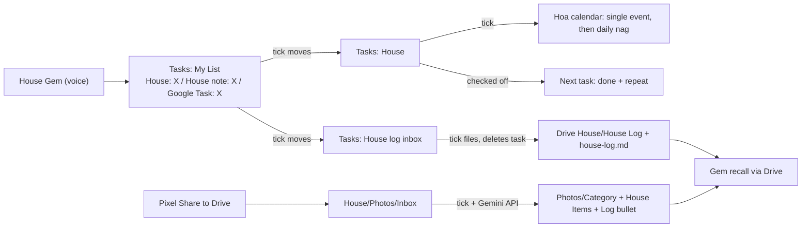

# House assistant

Voice reminders and a house log for moses.hoavo@gmail.com (America/Chicago).
Built 2026-09-25. No extra cost: Google AI Pro (Gemini), Google Tasks, Apps Script,
Google Drive for desktop.

Talk to the House Gem starting with **"Google Task"**. Naming the app is what makes
Gemini connect Google Tasks to the chat (see Known limits). Pin one House chat;
follow-ups there do not need the phrase.

- **Reminders:** "Google Task, nhắc mình thay lọc lò sưởi" ("remind me to change the furnace filter"). It asks
  how often it repeats, the first due date, and whether to nag daily. The reminder
  shows on the Hoa calendar and nags every day from the due date until the task is
  checked off. Checking it off schedules the next one from that day.
- **House notes:** "Google Task, changed the toilet fill valve, Performax, twist
  clockwise to remove". Saved with the date to the **House Log** Doc and
  `house-log.md` in `My Drive/House`.
- **Recall:** "what fill valve did I use?" in the House Gem. It answers from the Doc.
- **Photos:** on the Pixel, **Share > Drive > House / Photos / Inbox**. The hourly
  run reads the label (Gemini API, free tier), files the photo under
  `House/Photos/<Category>`, adds a **House Items** sheet row, and a Doc bullet
  with the photo link. Ask the Gem "Google Task, lọc gió size gì?" for the size
  and link.

## Pieces

| Piece | Where |
|---|---|
| Script | `Code.gs`, `appsscript.json` (this folder) |
| Apps Script project | **House assistant**, id in `.clasp.json` |
| Trigger | hourly, runs `tick()` |
| Voice front end | Gemini Gem **House**, instructions in `gemini-gem.md` |
| Reminders | Google Tasks list **House** |
| Notes waiting to be filed | Google Tasks list **House log inbox** |
| Log | Drive `My Drive/House/House Log` (Doc) and `house-log.md` |
| Items | Drive `My Drive/House/House Items` (Sheet) and `house-items.md` |
| Photos | Drive `My Drive/House/Photos/Inbox` → `<Category>` after filing |
| PC copy | Drive for desktop, Mirror mode, on the personal PC |

## Flow



Gemini can only add tasks to the default list (My List), so the Gem puts a title
prefix on everything and `sortDefaultList_()` moves prefixed tasks to the right
list. Unprefixed My List tasks are left alone.

## Task format (the contract)

Title: `House: <name>` or `House note: <subject>` (also `House reminder:`,
`House log:`). The prefix is removed when the task is moved.

Safety net for tasks made by plain Gemini, or by the Gem without formatting: a
title starting `Google Task:` / `Task nhà:` / `House task:` is a reminder if the task
has a due date, otherwise a note (`classifyTitle_()`; titles are NFC-normalized
first so decomposed Vietnamese accents still match).

Reminder fields, one per line in the notes, or `[a: b; c: d]` in the title:

| Field | Values | Default |
|---|---|---|
| `repeat:` | `none`, `<N> days/weeks/months/years`, `weekly`, `every 6 months` | none |
| `nag:` | `daily`, `off` | daily |
| `calendar:` | calendar name | `Hoa` |
| `time:` | `09:00`, `7pm` | 09:00 |
| `snap:` | weekday, moves the next due date to that day or later | none |

Other note lines become the event description. House notes: each line is a bullet;
optional `date: YYYY-MM-DD` sets the entry date (otherwise the day it was created).

## House Log layout

One HEADING2 per topic, dated bullets under it (`2026-09-25: Performax`). A note
whose title matches an existing topic is added to the end of that section. Match is
case- and punctuation-insensitive, then falls back to one title containing the
other (4+ letters). No match starts a new section at the bottom (no categories,
no sorting). A detail already in the section is skipped (`detailKey_()`: date
prefix, case and punctuation ignored); reworded repeats still get added. The Gem just
picks a short "thing" name (`Toilet fill valve`); it must not look up the Doc
first, because a Drive lookup before the Tasks call made Gemini claim it had no
Tasks access and create nothing. `house-log.md` is regenerated from
the Doc on every filing, so edit the Doc, not the `.md`. Legacy
`YYYY-MM-DD - Topic` headings are converted on the next filing.

The Gem accepts English or Vietnamese and writes tasks in English (brand and part
names kept verbatim). It must never use Google Keep; Apps Script cannot read Keep.

## Photos

Google Photos Library API cannot read the user's library (March 2025). Photos go
through Drive instead.

On the Pixel: take the photo, **Share > Drive**, folder **House / Photos / Inbox**.
Drive remembers the last folder. Optional: Inbox folder menu > Add to Home screen.

Hourly `processPhotos_()` (needs script property `GEMINI_API_KEY` from
[aistudio.google.com/apikey](https://aistudio.google.com/apikey), same Moses
account, free tier; Google may use those photos to improve its products):

1. Lists images in Inbox, oldest first, up to 20 per run, 7 seconds apart.
2. Sends the image to Gemini `generateContent` with a JSON schema. Model is
   `GEMINI_MODEL` if set, else `geminiModel_()` lists models and picks the first
   of `gemini-3.8-flash` … `gemini-2.5-flash`. A 404/zero-quota skip is stored in
   `GEMINI_MODEL_SKIP` and the next run picks another.
3. Renames to `YYYY-MM-DD Topic - Brand Model Size.jpg`, moves to
   `Photos/<Category>` (HVAC, Plumbing, Electrical, Paint, Appliances, Tools,
   Safety, Outdoor, Supplies, Other). File description holds the extracted fields.
4. Appends a **House Items** row: Date, Category, Topic, Item, Brand, Model,
   Size/Dimensions, Color/Finish, Serial, Price, Store, Link, How to use / Notes,
   Photo. Regenerates `house-items.md` grouped by category.
5. Adds a House Log bullet under the topic:
   `2026-09-25: Photo: Filtrete MERV 11, 16x25x1, $24.97 Home Depot - <url>`.
   Existing merge + `detailKey_` skip apply.
6. After 3 failures the file goes to `Photos/Needs review` and a bullet is added
   under **Photos to review**.

Run `checkGemini` in the editor after setting the key to confirm the model.

The Gem's Recall section also reads **House Items** and quotes size, model and
serial exactly. A follow-up like "that filter is for the upstairs unit" is a
normal house note on the same topic. Do not send photos into the Gem chat to
catalog them.

## Behavior

- Before the due date, or with `nag: off`: one 1-hour event at the due time.
- On and after the due date with `nag: daily`: a daily series from today until done.
- Checked off: events removed; new task due = completion date + `repeat`, snapped
  to `snap:` if set. `repeat: none` just stops.
- Task deleted: its events are removed on the next run.
- Event deleted by hand: recreated on the next run (the task is the source of truth).
- No due date: today is used and written back to the task.
- Events are tagged `managedId:until-done:<taskId>` in the description. Event and
  series ids are kept in script property `STATE`, so the script never scans long
  date ranges (CalendarApp throws "Service invoked too many times" if it does).
- Months/years clamp to month end (Aug 31 + 6 months = Feb 28).

Script properties: `STATE` (JSON), `LOG_DOC_ID`, `LOG_MD_ID`, `GARAGE_MIGRATED`,
`ITEMS_SHEET_ID`, `ITEMS_MD_ID`, `GEMINI_API_KEY` (required for photos),
optional `GEMINI_MODEL`, `GEMINI_MODEL_SKIP`, `PHOTO_TRIES`, `HOUSE_FOLDER`.

## Deploy changes

```bash
cd apps-script/house-assistant
clasp push -f
```

clasp 3.4.1 (`npm i -g @google/clasp`), logged in as moses.hoavo@gmail.com
(`clasp show-authorized-user`). `.claspignore` only pushes `Code.gs` and
`appsscript.json`. If new scopes are added to `appsscript.json`, run `install` or
`tick` once in the editor in Moses's Chrome to grant consent. Test pure helpers
(parsing, dates) locally with Node by stubbing `Utilities` and `Session`.

## Recreate from scratch

1. Apps Script: new project at script.google.com as moses.hoavo@gmail.com, put its
   id in `.clasp.json`, enable the user setting "Google Apps Script API"
   (script.google.com/home/usersettings), then `clasp push -f`. The manifest adds
   the Tasks advanced service and the scopes.
2. In the editor, run `install` and approve permissions (Advanced > Go to project).
   It creates the hourly trigger, the Tasks lists, the Drive folder and log files
   on first use, and adds the garage lube task (guarded by `GARAGE_MIGRATED`; on a
   fresh project it creates the House task due 2027-03-06).
3. Gemini app > Gems > New Gem, name **House**, paste the instructions from
   `gemini-gem.md`. Make sure Google Tasks, Calendar and Drive/Workspace are
   connected (type `@` in Gemini to see the list).
4. Optional, so plain "Hey Google" works without opening the Gem: add this to Gemini
   Settings > Personal Intelligence > Instructions for Gemini:

   > When I start with "Google Task" about the house, create a Google Task in my
   > default list.
   > If it is something I did or learned, title it "House note: <short English
   > topic>" with each detail on its own line in the notes. If it is something to do,
   > ask how often it repeats, the first due date and whether to nag daily, then
   > title it "House: <name>" with the due date and notes lines "repeat: <N>
   > <days|weeks|months|years>" or "repeat: none", and "nag: daily" or "nag: off".

   Even if Gemini ignores the format, the script still picks up `Google Task:` titles.
5. Personal PC: Google Drive for desktop, Mirror mode, keep house files in
   `My Drive\House`. No `.git` folders inside Drive.
6. Photos: create a Gemini API key at aistudio.google.com/apikey (free tier). In
   Apps Script > Project Settings > Script properties, add `GEMINI_API_KEY`.
   Run `tick` once to grant Sheets + external request scopes, then `checkGemini`.

## Current reminders

- Lube garage door & spring: due Sat 2027-03-06 9:00 on Hoa, `repeat: 6 months`,
  `snap: saturday`, `nag: daily`.

## Known limits

- Up to an hour of lag (hourly trigger). Run `tick` in the editor to apply now.
- **Gemini connects Google Tasks per chat, based on the user's message**, not the
  Gem instructions ([Google help](https://support.google.com/gemini/answer/15229592):
  "For every new conversation, ask the Gemini app to get or add something from your
  personal Google Workspace explicitly ... You don't need to do this for follow-up
  questions in the same chat"). Without a Tasks word in the message, the chat has
  no Tasks tool, and the model truthfully says so. No instruction wording fixes
  that. "Ghi chú" / "note" route to Keep or nothing, and a made-up phrase
  ("Task nhà") is not recognized either (tested 2026-09-25: three refusals). The
  product name "Google Task" is the wake phrase. A chat that already refused is a dead end; start a New chat.
- Gemini sometimes says it created a task when it did not. Check Tasks if unsure.
- The repo's Python CLI token only has Calendar scope, so from the CLI you can
  verify events but not Tasks or Drive.
- Cursor's built-in browser is too narrow for Google Tasks and OAuth popups; use
  Chrome (Moses profile).
- Anything in `My Drive/House` (including tax files) is readable by Gemini.
- Photo catalog uses the Gemini API **free** tier: no extra cost, but Google may
  use those images to improve its products. Serial numbers and receipts go through
  the API. A paid key (billing linked, same property) opts out of that.

## Ideas for later

- Weekly digest email of open House tasks and recent log entries.
- Attach more than one photo per item (before/after, receipt + label).
- A `snooze: 3 days` field that pushes the due date without completing.
